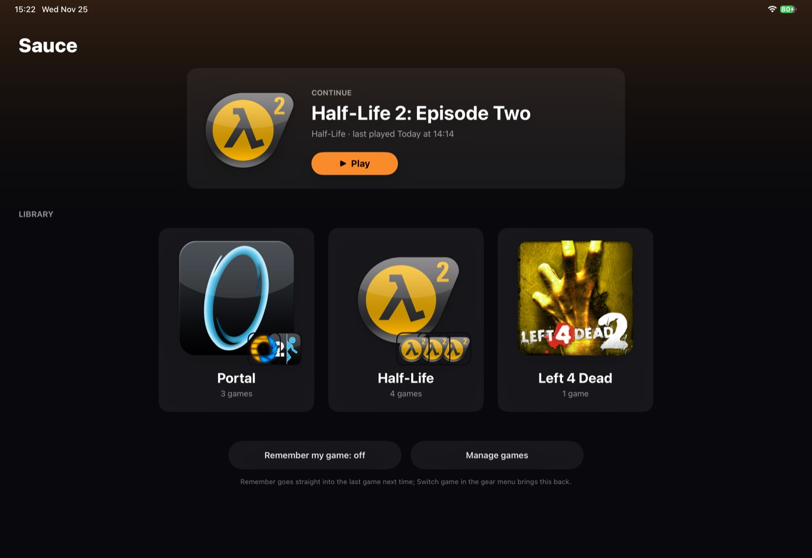
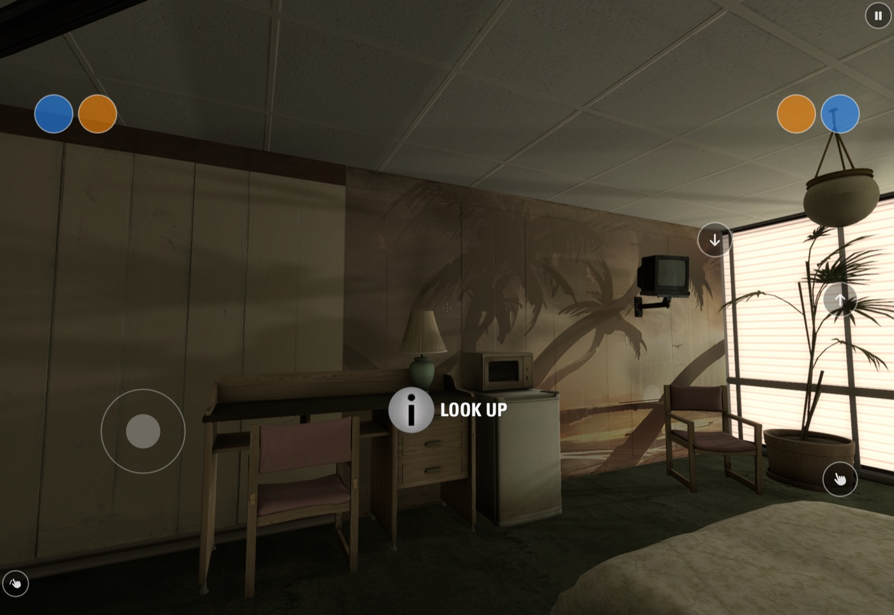
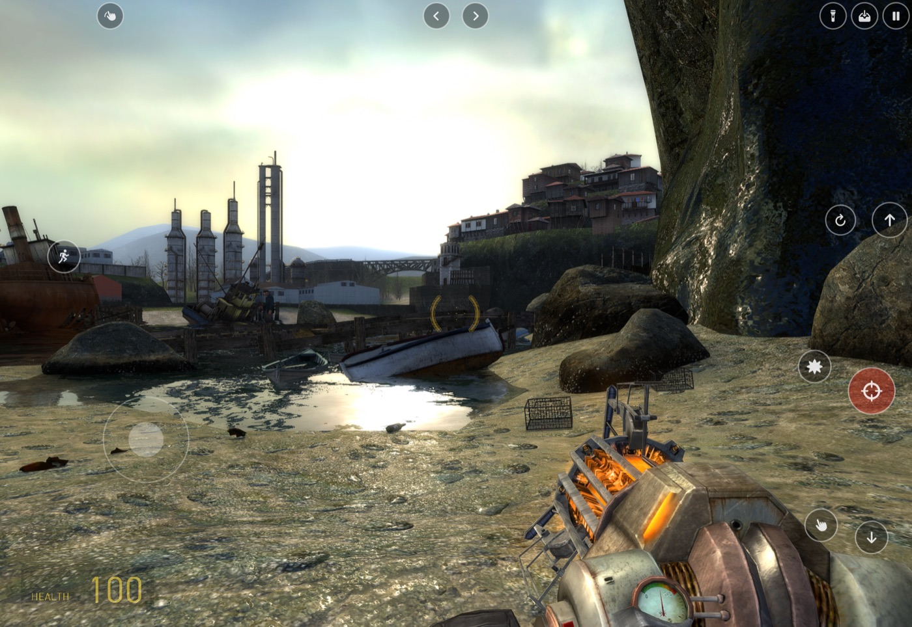
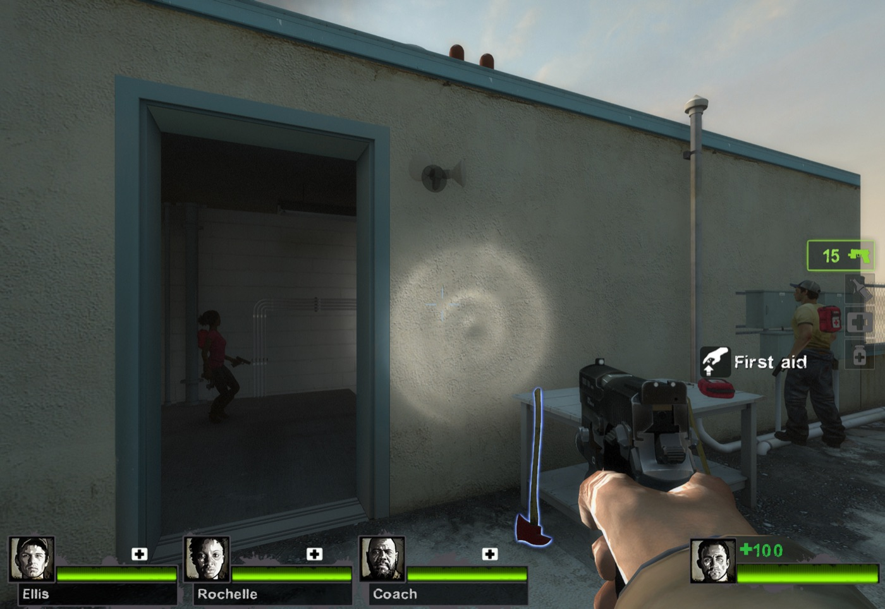

# Sauce

**One app for Portal, Portal 2, Portal Stories: Mel, Half-Life 2 (with Episode One, Episode Two and Lost
Coast) and Left 4 Dead 2, on iPad and Mac, up to 120 fps.** Bring your own Steam copy: no game files are
included, everything is built on your machine from the games you own.

> **Credit:** this is a fork of [kanapitsas's portal2-recomp](https://github.com/kanapitsas/source-recomp)
> (now source-recomp), which did the original static recompilation. The recompiler, the runtime and the Metal
> renderer are that project's work; this fork builds the app around them.

[](https://github.com/xcaspians/portal2-recomp/actions/workflows/ci.yml)


<p>
  
  
</p>
<p>
  
  
</p>

*All on an iPad Pro: the Sauce launcher, Portal 2, Half-Life 2: Lost Coast and Left 4 Dead 2 (offline, with bots).*

## What this fork adds

- **Series launcher:** one app, with Continue for your last game and a library grouped by series (Portal,
  Half-Life, Left 4 Dead). Works by touch or controller.
- **TV output:** plug into a TV or monitor, or use AirPlay; the game goes full screen there and the iPad can
  stay a touch controller.
- **Touch controls:** built for the iPad, with a layout editor, back taps for portals, gyro aiming and an
  in-game settings menu.
- **Controller support:** plug in a controller and the touch buttons step aside; touch can drive player 2 in
  Portal 2 co-op.
- **Phone as a controller:** scan a QR code and a friend's phone becomes a controller over Wi-Fi, with nothing
  to install.
- **Community maps and Workshop:** browse and play Portal 2's community test chambers on the iPad.
- **Extra games:** Portal, Mel, Half-Life 2 and its episodes, Lost Coast and Left 4 Dead 2 (offline only),
  on top of Portal 2.

## About this fork

I'm a hobbyist. I don't write this code by hand: I direct an AI coding assistant (Claude) that writes, tests
and documents it, and I decide what gets built and test it on my own devices.

> Unofficial fan project, not affiliated with or endorsed by Valve. Portal, Portal 2, Half-Life, Left 4 Dead,
> Steam and Source are trademarks of Valve Corporation. **Never attach game files** (or apps and generated
> code built from them) to issues or pull requests, and don't share them.

## Supported games

| Game | Mac | iPad / iPhone | Status |
|---|---|---|---|
| **Portal 2** | ✅ | ✅ Sauce | Plays start to finish; Community Maps, co-op on the LAN |
| **Portal Stories: Mel** | ✅ | ✅ Sauce | Plays; chapters 1–4 checked, a full playthrough not yet |
| **Half-Life 2** (+ Episodes, Lost Coast) | ✅ | ✅ Sauce | Menu and first chapters at 100–120 fps on iPad Pro; long play untested |
| **Portal** | ✅ | ⚠️ Sauce | Experimental: early chambers played |
| **Left 4 Dead 2** | ✅ | ⚠️ Sauce | Offline only: campaign map with bots and a horde on the Mac; first map on iPad Pro |
| **Portal 2: Community Edition** | 🚧 | — | 64-bit recompiler in progress: its launcher starts, no menu yet |

You must own each game on Steam. Left 4 Dead 2 builds never connect to Valve's online servers.

## Quick start

1. Install your games in **Steam** on your Mac, as usual.
2. Download the **Natif Installer** `.dmg` from the [latest release](https://github.com/xcaspians/portal2-recomp/releases/latest),
   open it and drag the app to **Applications**.
3. Open it: it lists the Sauce games it found in Steam. Tick the ones you want. A game that needs one more
   download (its Linux files) shows a line to paste into Steam's console, with a button that opens it.
4. Plug in your iPad or iPhone and unlock it.
5. Press **Install**. The first time takes a while: building Sauce on your Mac (half an hour or more), then
   copying 5–14 GB per game. Your saves are backed up to the Mac before anything on the device is replaced.

**Getting the Sauce app itself** happens in one of two ways:
- **Your own Apple ID** (a free one works): the installer builds Sauce on your Mac and signs it through
  Xcode. This needs Xcode and an Apple silicon Mac, and a free ID's copy must be refreshed every 7 days,
  which takes one click ([what a free Apple ID can do](docs/fork/FREE_APPLE_ID.md)).
- **TestFlight**: invite only, and not open yet ([proposal](docs/fork/TESTFLIGHT_PROPOSAL.md)).

The same installer builds the Mac apps too (its **Mac** tab, Apple silicon only).

## Building it yourself

From Terminal instead of the DMG:

```sh
git clone https://github.com/xcaspians/portal2-recomp.git
cd portal2-recomp
make installer-dmg              # or tools/build_installer.sh: the app without a DMG
./setup.sh                      # the Mac apps
./setup.sh --ios                # the iPhone and iPad app, signed with your Xcode account
```

Release signing and notarization: [docs/usage.md](docs/usage.md#releases).

---

The rest of this page is upstream's full documentation, still accurate for this fork.

## About the recompiler

This project builds native Mac and iPhone apps from your own copies of
Portal 2, Half-Life 2 (with Episode One, Episode Two and Lost Coast),
Portal and (Mac only) Portal Stories: Mel. It
translates the x86 code of the Linux versions into C, then compiles it for
Apple silicon. No emulator, no Wine, no Rosetta.

**You must own the games.** This repository has no game files and no Valve
code: everything is generated on your machine from your own copy. The app and
the generated code contain Valve's game, so keep them for yourself and don't
share them.

> Unofficial fan project, not affiliated with or endorsed by Valve. Portal,
> Portal 2, Half-Life, Steam and Source are trademarks of Valve Corporation.
> Provided as is, without warranty.

## Find your way

| I want to | Go to |
|---|---|
| **See what works** | [Status](#status) |
| **Play on a Mac** | [Quick start](#quick-start-mac) · [Full install](#install-on-mac) |
| **Play on an iPhone** | [Install on iPhone](#install-on-iphone) |
| **Fix a problem** | [Troubleshooting](#troubleshooting) |
| **Understand the project** | [How it works](#how-it-works) · [Documentation](#documentation) |
| **Help** | [Contributing](#contributing) · [Development and tests](#development-and-tests) |

## Status

Updated 24 November 2026. Latest release:
[v0.4.0](https://github.com/kanapitsas/source-recomp/releases/tag/v0.4.0)
(18 November). Items marked *`main` only* are merged but not in a release yet.

| Game | Mac | iPhone |
|---|---|---|
| [**Portal 2**](#portal-2) | **Playable** | **Playable**, steady 60 fps on an iPhone 15 Pro Max |
| [**Half-Life 2**](#half-life-2) | **Playable**: main game played for hours by us and by several players | Experimental: 60 fps in a short test |
| **Episode One, Episode Two, Lost Coast** | Experimental: first maps load, not played through | Experimental: data is copied, not played |
| [**Portal**](#portal) | Experimental: first chamber played, six more load and run | Experimental: a user played up to chamber 16 at 60 fps on an iPhone 18 Pro (#53) |

In an experimental game, a crash ending with `target not recompiled` is a
missing root. Please report it with the log.

### Portal 2

- **Mac**: on an M3 Pro, Metal (the default) runs a scene at 122 fps where
  OpenGL gets 81 (2560×1440, MSAA 4×;
  [measurements](STATUS.md#measurements)).
- **iPhone**: touch controls and portals fired by **tapping the back of the
  phone**.
- **Controllers**: work on Mac and iPhone (tested with an 8BitDo SN30 Pro).
  On Mac, turn Steam Input off for Portal 2.
- **Co-op** over the local network: a Mac hosts, an iPhone or a second copy
  on the same Mac joins. Connection and map load are checked; a full co-op
  course has not been played yet.
- **Puzzle Maker** (#42): Build and Play works on Mac, with the map compilers
  recompiled too. Opt-in with `./setup.sh --puzzle-maker`, about ten more
  minutes and 220 MB ([details](docs/puzzlemaker.md)). *`main` only*: the
  installer's checkbox for it (#49), and publishing chambers to the Workshop
  (#50), reported working by a contributor but not tested by us yet.
- **Native plugins** (#32): a server plugin built as a macOS arm64 dylib loads
  where the game expects a Linux `.so`
  ([details](docs/native-plugins.md)).

### Half-Life 2

[Full details](#half-life-2-and-its-episodes).

- **Mac**: playable. 120 fps with Metal on an M3 Pro at 1280×720. Players
  report an hour on an M4 Pro with no issue, play from Highway 17 on at mostly
  60 fps (dips to 50) on an M4 Air at 2560×1664, maximum settings, with a
  DualShock 4, and it running on M2 and M5 Macs. No game bug is open; nobody
  has reported a start-to-end playthrough yet.
- **iPhone**: touch controls and gyro aiming, one short session.

### Portal

Contributed in #31. [Full details](#portal-experimental).

- **Mac**: `testchmb_a_00` played from the app; `testchmb_a_01` to `a_05` and
  `a_10` load and run without trapping
  ([what was tested](docs/portal1.md#what-was-tested)). It needs the current
  Linux binaries (depot 404). The `save` crash of #44 is fixed in the
  recompiler and checked in Half-Life 2, not confirmed in Portal yet.
- **iPhone**: a user played up to chamber 16 on an iPhone 18 Pro at a steady
  60 fps without a crash (#53); back taps were not reliable there. Our own
  test is a short session only (menu and touch layout).

### Portal Stories: Mel

Experimental, Mac only for now ([details](#portal-stories-mel-experimental)).

- **Mac**: menu (with Bink video), chambers across chapters 1–4, Metal and
  OpenGL renderers, audio, and save/load work; a full playthrough has not been
  tested yet.

### All games

- **Install**: the Natif Installer app from the
  [releases](https://github.com/kanapitsas/source-recomp/releases), or one
  command, `setup.sh`, for one game or all. Only the Xcode command line
  tools are required.
- **Multiplayer**: only Portal 2's LAN co-op. No Steam invites or online
  play, and Half-Life 2: Deathmatch is not supported.
- **In review**: Portal Stories: Mel (#52), not merged.

## Quick start (Mac)

You need an Apple silicon Mac on macOS 13 or newer, and the game installed
in Steam with the account that owns it.

1. Download `Natif-Installer-<version>.zip` from the
   [latest release](https://github.com/kanapitsas/source-recomp/releases/latest),
   unzip it and open **Natif Installer**. It offers to install the Xcode
   command line tools if they are missing.
2. Get the game's Linux binaries: click **Open Steam console** in the
   installer and paste the command it shows, `download_depot 620 661` for
   Portal 2 (`220 224` for Half-Life 2, `400 404` for Portal). Wait for
   “Depot download complete”.
3. When the installer has found them, tick the games and click **Build**
   (about 10 minutes each for Portal 2 and Portal, 10 to 20 for Half-Life 2),
   then open the game from the installer. The apps are in `~/Applications`.

Terminal instead of the installer, iPhone, and the details:
[What you need](#what-you-need), [Install on Mac](#install-on-mac),
[Install on iPhone](#install-on-iphone).

## How it works

1. `tools/elfprep.py` and `tools/gameprep.py` lay out the Linux ELF modules
   (`engine.so`, `client.so`, ...) at fixed guest addresses, apply their
   relocations offline and record imports, exports and entry points.
2. `tools/lift.py` translates every x86 function into a C function; `clang`
   compiles the result together with the runtime into one ARM64 executable
   (`build/portal2-native`; `build/hl2/hl2-native` for Half-Life 2). Indirect call targets that the static pass
   misses are collected at run time into `config/game-roots.json`.
3. The runtime (`runtime/`) implements what the binaries import: libc,
   pthreads and futexes, SDL2, OpenGL, Direct3D 9 and Steam. Guest threads
   are real threads serialized by one lock, the guest gate
   ([docs/fast-path.md](docs/fast-path.md)).
4. Steam calls are forwarded to Valve's own arm64 `libsteam_api.dylib`
   (from Steamworks.NET) through generated i386 → arm64 proxies; there is no
   Steam emulator ([docs/steam.md](docs/steam.md)).
5. Rendering has two paths. The default is Valve's `shaderapivk.so` talking
   to **mtld3d**, a native Direct3D 9 on Metal
   ([docs/d3d9-bridge.md](docs/d3d9-bridge.md)); mtld3d is the project, the
   library it builds is `libd3d9metal`. The fallback is Valve's `togl`,
   translating Direct3D 9 to legacy OpenGL 2.1
   ([docs/gl-audit.md](docs/gl-audit.md)).
6. On iPhone the OpenGL path goes through gl4es, with every shader rewritten
   to GLSL ES 3.00 ([docs/ios.md](docs/ios.md)); the Metal path is linked
   statically.

## What you need

- An Apple silicon Mac on macOS 13 or newer with the Xcode command line tools
  (`xcode-select --install`, which also brings Python 3.9). SDL2, FreeType,
  Fontconfig and the Metal renderer come prebuilt from this project's
  releases (about 4 MB, SHA-256 checked); with
  `brew install sdl2 freetype fontconfig`, Homebrew's are used instead.
- Portal 2 on Steam:
  - the game folder (the one with `portal2/`, `platform/` and `bin/`); the
    Windows version works;
  - the Linux binaries: open the Steam console (`open steam://open/console`)
    and type `download_depot 620 661` (about 90 MB).
- And/or Half-Life 2 on Steam:
  - the game data (the current version, with `hl2_complete/`): install it
    with Steam, or use `download_depot 220 221` in the Steam console;
  - the Linux binaries: `download_depot 220 224` (about 320 MB).
  Wait for “Depot download complete” for each download.
- And/or Portal on Steam:
  - the game data (the one with `portal/` and `platform/`): install it
    with Steam, or use `download_depot 400 401` in the Steam console;
  - the Linux binaries: `download_depot 400 404` (about 150 MB).
- And/or Portal Stories: Mel on Steam (Mac only):
  - the game data (with `portal_stories/` and `platform/`): install it with
    Steam, or use `download_depot 317400 317401` (about 8.6 GB) in the Steam
    console;
  - the Linux binaries: `download_depot 317400 317404` (about 90 MB).
- Optional: Rust 1.99 or newer from [rustup](https://rustup.rs) builds the
  Metal renderer from source instead of using the prebuilt one; the iPhone
  app needs it for Metal (Homebrew's `rust` has no iOS target).
- For iPhone: Xcode with your Apple ID (a free account works),
  `brew install xcodegen cmake ninja`, an iPhone on iOS 17 or newer
  connected by cable with Developer Mode on, and about 12 GB free on it.
  Tested on an iPhone 15 Pro Max only.

## Install on Mac

**Without Terminal**: download `Natif-Installer-<version>.zip` from the
[latest release](https://github.com/kanapitsas/source-recomp/releases/latest),
unzip it and open **Natif Installer**. It is signed; if macOS refuses to
open it, go to System Settings > Privacy & Security and click **Open
Anyway**. The installer checks the Xcode command
line tools (and offers to install them), finds Portal 2, Half-Life 2,
Portal and their Linux binaries (with the Steam console commands to paste when they are
missing), lets you tick the games to build, then runs `setup.sh` for you.
Its copy of the code and the builds (about 5 GB per game) live in
`~/Library/Application Support/Portal 2 Natif Build`, as with the first
Portal 2 installer, so an update rebuilds only what changed; its log is
`~/Library/Logs/NatifInstaller.log`.

**With Terminal**:

```sh
git clone https://github.com/xcaspians/portal2-recomp.git
cd portal2-recomp
./setup.sh                    # every game found: Portal 2, Half-Life 2, Portal, Mel
./setup.sh --game hl2         # one game (portal2, hl2, portal1, mel), or --game all
./setup.sh --puzzle-maker     # Portal 2 with its map compilers, for the Puzzle Maker (docs/puzzlemaker.md)
./setup.sh "/path/to/Portal 2" "/path/to/depot_661"   # folders Steam did not put in the usual place
```

Without paths, `setup.sh` looks where Steam usually puts the games and their
Linux binaries, and builds each game it finds complete (`./setup.sh --detect`
lists them without building). It downloads Valve's `libsteam_api.dylib`
(from Steamworks.NET, SHA-256 checked), builds each game (about 10 minutes
for Portal 2, 10 to 20 for Half-Life 2, about 10 for Portal and about 15 for
Portal Stories: Mel the first time) and creates `~/Applications/Portal 2 Natif.app`,
`Half-Life 2 Natif.app`, `Portal Natif.app` and/or `Portal Stories Mel Natif.app`.
Re-running it is safe and quick, and adding a game later does not rebuild
the others. "Natif" is French for native; the name is kept so
existing installs are updated in place.

Each app contains its own executable and libraries; the game files stay
where Steam put them. After a rebuild or a change to `config/local.json`, run
`python3 tools/make_app.py` (`--game hl2|portal1` for another game) to update the app
(`--dest` for another folder).
Downloads and iOS libraries go to `deps/` (`P2_DEPS` overrides it).
`P2_HOST_DEPS=homebrew` or `bundle` forces where the host libraries come
from; `P2_APP_DIR` puts the app elsewhere than `~/Applications`.

## Install on iPhone

First create an Apple Development certificate (Xcode > Settings > Accounts >
Manage Certificates > + > Apple Development), then:

```sh
./setup.sh --ios              # every game found; --game hl2 for one, or paths as on Mac
```

It builds, signs and installs each app and copies the game data (once:
about 11.5 GB for Portal 2, 10 GB for Half-Life 2, 4 GB for Portal;
`tools/ios_device.sh data` copies it again after a reinstall). Half-Life 2's
and Portal's iPhone apps are experimental
([docs/hl2.md](docs/hl2.md#iphone), [docs/portal1.md](docs/portal1.md#iphone)).
On the phone, trust your account in Settings > General > VPN & Device
Management. With a free account, re-run `./setup.sh --ios` every 7 days.
`P2_TEAM_ID` sets the team when it cannot be read from the certificate;
`P2_DEVICE` picks the iPhone when several are connected.
More in [docs/ios.md](docs/ios.md); custom maps and addons in [docs/mods.md](docs/mods.md).

## Play

On Mac, open Steam with the account that owns the game, then open
**Portal 2 Natif**, **Half-Life 2 Natif** or **Portal Natif** (it starts
Steam if needed). The game language follows
your `-language` argument, `P2_LANGUAGE`, `config/local.json`, then Steam
and macOS ([details](docs/usage.md#game-language)).

On iPhone: left stick to move, right half of the screen to look, buttons to
jump, crouch, use and pause, and a tap on the back of the phone (left or
right) to fire a portal. Everything is tunable in Settings > Portal 2. The
iPhone version has no Steam, but it can join a Mac in LAN co-op. Half-Life 2
has its own touch layout ([docs/hl2.md](docs/hl2.md#iphone)); Portal keeps
Portal 2's, with both portal buttons and back taps firing.

**Controllers** work on all three. On Mac, turn Steam Input off for Portal 2 in
Steam (Properties > Controller), otherwise Steam keeps the controller to
itself ([why](docs/usage.md#controllers)). On iPhone, the on-screen controls
hide themselves when a controller connects.

**Co-op** works over the local network: a Mac hosts, and an iPhone or a
second copy on the same Mac joins by IP address
([how](docs/usage.md#lan-co-op-portal-2)). Two separate Macs, Steam invites and play
over the internet are not tested.

## Renderer: Metal or OpenGL

The game renders with **Metal** when `libd3d9metal` is available, and with
**OpenGL** otherwise. Metal measured about +50 % fps on a Mac and +20–25 % on
an iPhone, and fixes the too-dark image of OpenGL on iPhone.

- If Rust is installed, `setup.sh` fetches and builds `libd3d9metal` (about a
  minute) from a pinned commit of
  [mtld3d's native host branch](https://github.com/kanapitsas/mtld3d/tree/feat/native-host).
  Without Rust it uses the prebuilt library from the same commit (in the
  host libraries download); if neither works, the game uses OpenGL. If the build fails,
  a library built by an earlier run is kept as long as its file still
  exists; otherwise OpenGL. `P2_NO_METAL=1 ./setup.sh` skips it.
- The end of `setup.sh` tells which renderer the Mac app and the iPhone app
  use. The iPhone library is built separately and can still fall back to
  OpenGL.
- `P2_RENDERER=opengl` forces OpenGL; on iPhone, use Settings > Portal 2 >
  Rendering > Renderer.
- **F3** on Mac shows the renderer and the frame rate; on iPhone, the counter
  in the top-left corner does.

Details: [docs/d3d9-bridge.md](docs/d3d9-bridge.md).

## Uninstall

```sh
./uninstall.sh
```

For each game installed, it asks before moving the app and its log to the
Trash, and asks again for the saves; then, on its own yes, the installer's
build folder. It never touches the Steam game files or the Linux binaries.

## Half-Life 2 and its episodes

The same recompiler also turns the Linux version of **Half-Life 2** (the
current Steam build, 20th anniversary update) into a native Mac app. **You
must own Half-Life 2**; as for Portal 2, nothing from Valve is in this
repository.

Install Half-Life 2 with Steam, or fetch its game data from the Steam console
with `download_depot 220 221`. Also fetch its Linux binaries with
`download_depot 220 224` (about 320 MB). Wait for “Depot download complete”
for each download. Then tick it in the
installer, or run `./setup.sh` (or `./setup.sh --game hl2`) in the same
checkout as Portal 2: each game has its own build folder. It creates
`~/Applications/Half-Life 2 Natif.app`, with its own saves folder.

- **Status**: the main game is playable on Mac; the episodes, Lost Coast
  and the iPhone app are experimental.
- **Tested**: a few hours of the main game on an M3 Pro, at 1280×720:
  120 fps with Metal (the display's limit; the default, as for Portal 2) and 91 with
  OpenGL (`--release` build).
- **iPhone**: `./setup.sh --game hl2 --ios` builds the app; 60 fps on an
  iPhone 15 Pro Max in a first short test ([docs/hl2.md](docs/hl2.md#iphone)).
- **Dark indoors**: by design, the maps cap the exposure. Use the flashlight
  (F) or raise Options > Video > Brightness.
- **Episodes and Lost Coast**: start them from the main menu (HL2:
  Episode One, HL2: Episode Two; Lost Coast is under Extras). Their first
  maps load and render on Metal; they have not been played through.
- **Not yet**: some indirect call targets are still being found: a crash
  ending with `target not recompiled` is one more to add (please report it
  with the log, `~/Library/Logs/HalfLife2Natif.log`).

Details, manual setup and measurements: [docs/hl2.md](docs/hl2.md).

## Portal (experimental)

The same recompiler also turns the Linux version of **Portal** (Steam app 400,
the Source 2013 build) into a native Mac and iPhone app. **You must own
Portal**; as for Portal 2, nothing from Valve is in this repository.

Install Portal with Steam, or fetch its game data from the Steam console with
`download_depot 400 401`. Also fetch its Linux binaries with
`download_depot 400 404` (about 150 MB). Wait for “Depot download complete”
for each download. Then tick it in the installer, or run `./setup.sh` (or
`./setup.sh --game portal1`) in the same checkout as Portal 2: each game has
its own build folder (`build/portal1`). It creates
`~/Applications/Portal Natif.app`, with its own saves folder.

- **Tested**: the menu and `testchmb_a_00`, and `testchmb_a_01`–`a_05` plus
  the later `testchmb_a_10` started with `+map` and left running 70 s without
  trapping (see [docs/portal1.md](docs/portal1.md#what-was-tested)); the
  indirect call roots are still being discovered, so later chambers may trap.
- **iPhone**: `./setup.sh --game portal1 --ios` builds the app. A user played
  up to chamber 16 on an iPhone 18 Pro at a steady 60 fps without a crash
  ([#53](https://github.com/kanapitsas/source-recomp/issues/53)); our own
  test is a short session only.
- **Touch**: Portal 2's layout, both portal buttons, back taps fire the
  portal; the Settings page is Portal 2's. Back taps were reported
  unreliable on an iPhone 18 Pro (the thresholds were calibrated on an
  iPhone 15 Pro Max): try Settings > Tap sensitivity.
- **Not yet**: a full playthrough, later chambers (energy balls), performance
  measurements. A crash ending with `target not recompiled` is one more root
  to add: please report it with the log, `~/Library/Logs/PortalNatif.log`.

Details, manual setup and what differs from Portal 2:
[docs/portal1.md](docs/portal1.md).

## Portal Stories: Mel (experimental)

The same recompiler also turns the Linux version of **Portal Stories: Mel**
(Steam app 317400, Mac only for now) into a native Mac app. **You must own
Portal 2 and have Portal Stories: Mel on Steam**; nothing from Valve or Prism
Studios is in this repository.

Install Portal Stories: Mel with Steam (or `download_depot 317400 317401`,
about 8.6 GB) and fetch its Linux engine binaries with
`download_depot 317400 317404` (about 90 MB). Wait for “Depot download
complete”, then tick it in the installer or run `./setup.sh --game mel`.
`setup.sh` also fetches Debian bullseye's i386 `libstdc++.so.6` and
`libgcc_s.so.1` (SHA-256 checked), builds under `build/mel`, and creates
`~/Applications/Portal Stories Mel Natif.app`.

- **Tested**: main menu (with Bink video), `sp_a1_tramride`,
  `sp_a2_underbounce`, `sp_a3_paint_fling` and `sp_a4_overgrown` on Metal,
  `sp_a2_underbounce` on OpenGL, plus save and load.
- **Not yet**: iPhone support, a full playthrough, achievements, and any
  indirect call roots not yet exercised (report crashes ending in
  `target not recompiled` with `~/Library/Logs/PortalStoriesMelNatif.log`).

Details, manual setup and what differs from Portal 2:
[docs/mel.md](docs/mel.md).

## Troubleshooting

- **"Portal 2 game data is incomplete"**: the game needs
  `portal2_dlc2/scripts/editoritems.txt` even when you only play the campaign.
  The installer checks for a readable, nonempty file before building, and the
  app checks again before launching (an empty placeholder file is reported
  too: the game needs the real item definitions). In Steam, right-click
  Portal 2 > Properties > Installed Files > Verify integrity of game files;
  or fetch the complete data with `download_depot 620 621` and select
  `depot_621` in the installer. No rebuild is needed: the data is read at
  launch. Automatic detection prefers a complete copy over an incomplete
  Steam folder. An empty user override can also mask the original; the
  launch error names the effective file. This check detects missing or empty
  data, not every possible malformed or modded file.
- **"Steam is not running"**: the engine exits (status 100) without a
  logged-in Steam client; the log shows `steam: the Steam client is not
  running`. Open Steam first (the app tries to start it).
- **"Failed to create D3D9!"**: `-vulkan` was passed but `libd3d9metal` is
  missing or failed to initialize. Drop `-vulkan` or set `P2_RENDERER=opengl`.
- **No music or voices**: `setup.sh` warns when `bin/linux32/mssmp3.asi`,
  `mssvoice.asi` or `binkawin.asi` is missing from the game folder (Miles
  decodes the MP3 voice lines with them). They come with the Linux game data
  (`download_depot 620 621`); a Windows copy may lack them. Portal's come with
  its Linux depot (`download_depot 400 404`).
- **iPhone app stops launching after a week**: free Apple accounts give
  7-day profiles and allow 3 sideloaded apps; re-run `./setup.sh --ios`.
- **Logs**: Mac, `~/Library/Logs/Portal2Natif.log` (and
  `HalfLife2Natif.log`, `PortalNatif.log`); iPhone,
  `Documents/game.log` in the app's files once the Journal setting is on
  (`tools/ios_device.sh run` pulls it back).
- Diagnostics variables: [docs/usage.md](docs/usage.md#diagnostics) (Mac) and
  [docs/ios.md](docs/ios.md#diagnostics) (iPhone).

## Repository layout

- `src/`: `main.c`, the host entry point (`--images`, `--game-dir`,
  `--linux-root`, `--user-dir`, then the game's arguments).
- `runtime/`: the native runtime (libc, threads, SDL, GL, D3D9, Steam shims);
  `runtime/ios/` for the iPhone.
- `tools/`: ELF preparation, the lifter, build and run scripts, benchmarks.
- `tests/`: Python tests (`test_*.py`) and C checks (`checks_*.c`) linked
  into `abi-smoke`.
- `ios/`: app shell, Settings bundle, dependency build, signing project.
- `installer/`: the Mac installer app (SwiftUI, one file).
- `config/`: `game-roots.json`, `hl2-roots.json` and `portal1-roots.json`
  (indirect call roots of Portal 2, Half-Life 2 and Portal); `local.json` is
  yours and ignored by git.
- `docs/`: the documents listed below. `experiments/`: the Steam init probe and the HID controller probe.
- `build/` and `deps/`: generated, ignored by git. Portal 2 builds in
  `build/game` (and `build/ios`), Half-Life 2 in `build/hl2`, Portal in
  `build/portal1`.

## Development and tests

- `make check`: Python tests and `build/abi-smoke`, no game files needed.
- `make test INPUT_DIR=/path/to/depot_661/bin/linux32`: the full run; the
  path defaults to `linux_root` in `config/local.json`. `make sanitize` is
  the UBSan variant.
- `P2_STEAM_TESTS=1 make test`: live Steam tests, with the client running.
- Releases: `tools/build_host_deps.sh` builds the prebuilt host libraries
  (then update `HOST_DEPS_*` in `setup.sh`), `tools/build_installer.sh` the
  installer app and its zip; see [docs/usage.md](docs/usage.md#releases).
- CI (`.github/workflows/ci.yml`, macos-15): the Python tests, `abi-smoke`
  and `abi-smoke-ubsan`. It cannot build the full game, whose files are not
  in the repository.
- Manual build, run and diagnostics: [docs/usage.md](docs/usage.md).
  Project rules and bridge conventions: [CLAUDE.md](CLAUDE.md).

## Documentation

- [docs/usage.md](docs/usage.md): language, controllers, LAN co-op, manual build, diagnostics
- [docs/hl2.md](docs/hl2.md): Half-Life 2 and its episodes
- [docs/portal1.md](docs/portal1.md): Portal (experimental)
- [docs/ios.md](docs/ios.md): iOS port, controls, settings, back taps
- [docs/mods.md](docs/mods.md): custom maps, addon folders and console tweaks on iPhone and iPad
- [docs/backtap.md](docs/backtap.md): back-tap detector, recordings and dataset
- [docs/d3d9-bridge.md](docs/d3d9-bridge.md): Metal renderer (Direct3D 9 bridge)
- [docs/steam.md](docs/steam.md): Steam bridge
- [docs/fast-path.md](docs/fast-path.md): fast memory mode and direct calls
- [docs/gl-audit.md](docs/gl-audit.md): OpenGL audit of togl (25 Oct. 2026)
- [docs/lifter-coverage.md](docs/lifter-coverage.md): lifter coverage
- [STATUS.md](STATUS.md): the development log, with every measurement

## Contributing

Outside contributions merged so far:
#1 (d-ismlv, a Steam bridge call),
#2 (lukedavid2, the fullscreen mouse offset on notched MacBooks),
#31 (runty, Portal), #32 (hammerill, native plugins),
#42 (feolaney, the Puzzle Maker),
#50 and #51 (Zertrox123, Workshop publishing, file inodes and the lifter).

Welcome:

- **Crash reports** with the end of the game's log
  (`~/Library/Logs/Portal2Natif.log`, `HalfLife2Natif.log`,
  `PortalNatif.log`) and your Mac or iPhone model. A
  `target not recompiled` line names an indirect call root to add.
- **Test reports** for what is not tested yet: Portal's later chambers, a
  full co-op course, the Half-Life 2 episodes, other controllers, other Macs
  and iPhones.
- **Pull requests** that pass `make check` (what CI runs). For a new game or
  a large change, open an issue first, as in #29.

Never attach game files, generated C, built apps or binaries to an issue or
a pull request: they contain Valve's game.

## Credits

- [mtld3d](https://github.com/athei/mtld3d) (zlib) by Alexander Theissen,
  the Direct3D 9 on Metal behind the Metal renderer; its Wine-free build is
  discussed in [athei/mtld3d#1193](https://github.com/athei/mtld3d/issues/1193).
- [gl4es](https://github.com/ptitSeb/gl4es) (MIT) by ptitSeb, patched for iOS.
- For Portal 2: Community Edition's Direct3D 11 renderer (Mac, in progress), all fetched and built from source
  by `tools/build_dxvk_macos.sh`:
  - [DXVK](https://github.com/doitsujin/dxvk) (zlib) by Philip Rebohle and contributors: 1.10 as patched for
    macOS by Gcenx ([DXVK-macOS](https://github.com/Gcenx/DXVK-macOS)), with the non-Windows build of Joshua
    Ashton's [dxvk-native](https://github.com/Joshua-Ashton/dxvk-native) carried over.
  - [MoltenVK](https://github.com/KhronosGroup/MoltenVK) (Apache 2.0) by The Brenwill Workshop and the Khronos
    Group: Vulkan on Metal.
  - [glslang](https://github.com/KhronosGroup/glslang) (BSD-3/Apache 2.0) by the Khronos Group, for DXVK's
    own shaders.
- [SDL2](https://libsdl.org) (zlib), [FreeType](https://freetype.org) (FTL).
- [Steamworks.NET](https://github.com/rlabrecque/Steamworks.NET) (MIT), whose
  interface metadata generates the Steam bridge.
- Touch controls inspired by
  [MacNativeGames](https://github.com/ly05010419/MacNativeGames) (MIT).

Built in October and November 2026 by Raphaël Kanapitsas, with AI coding agents
(Anthropic's Claude Code and OpenAI's Codex) writing most of the code under
his direction. The history and [STATUS.md](STATUS.md) show the whole process.

## License

Copyright (C) 2026 Raphaël Kanapitsas and contributors.

[GNU GPL v3.0](LICENSE). It does not cover Portal 2, Half-Life 2, Portal or any Valve material.
