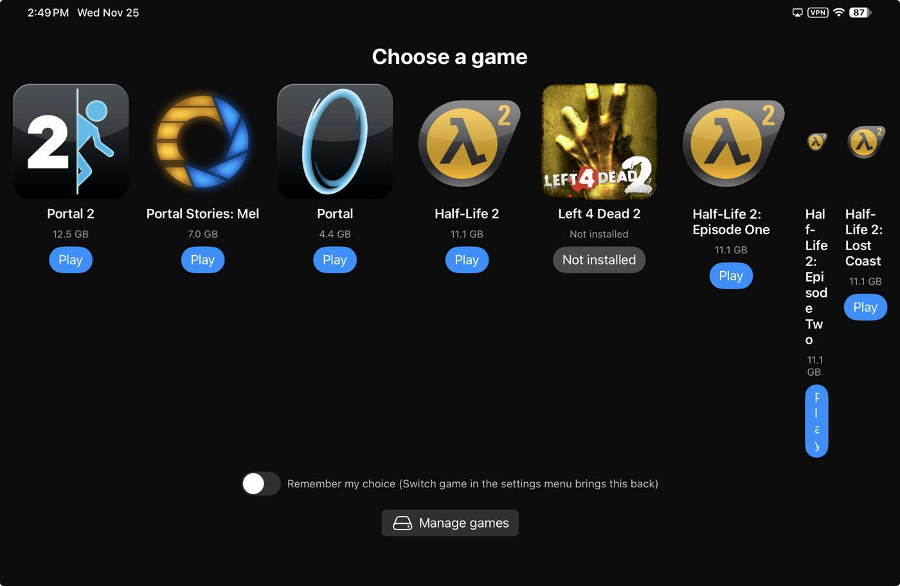
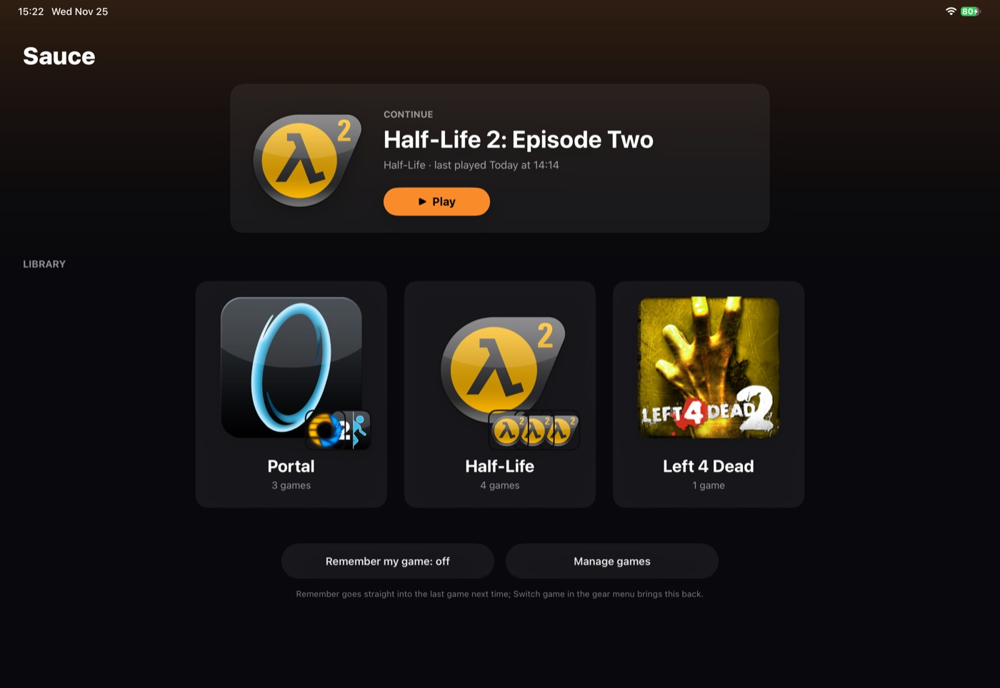
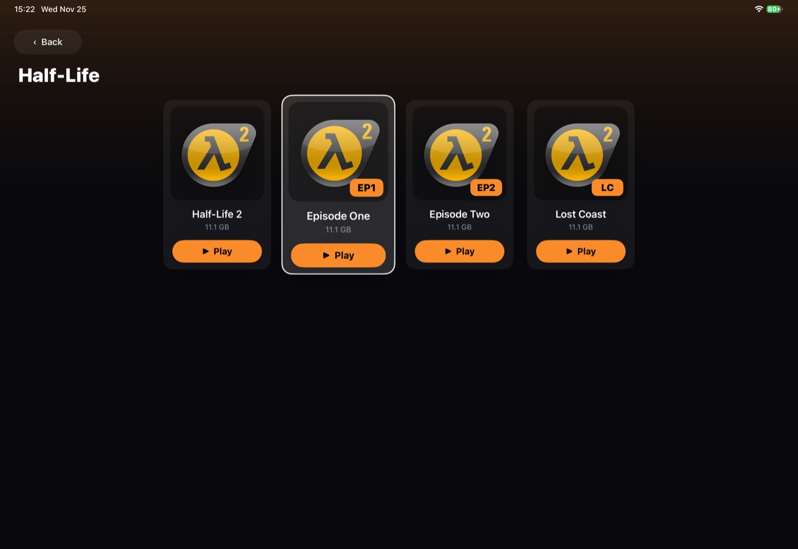
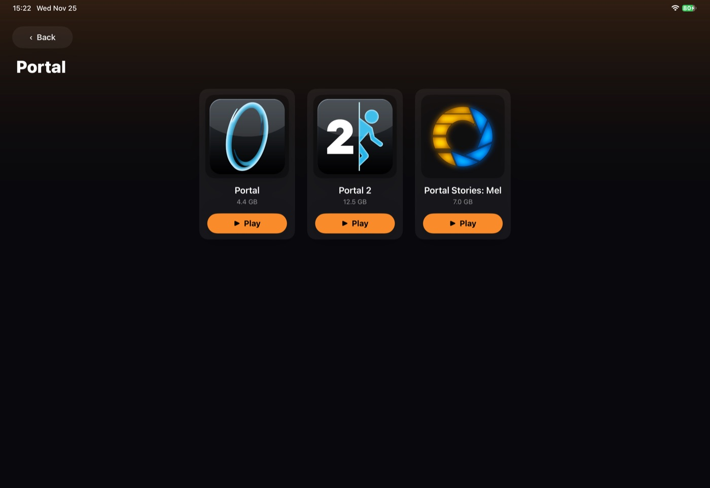
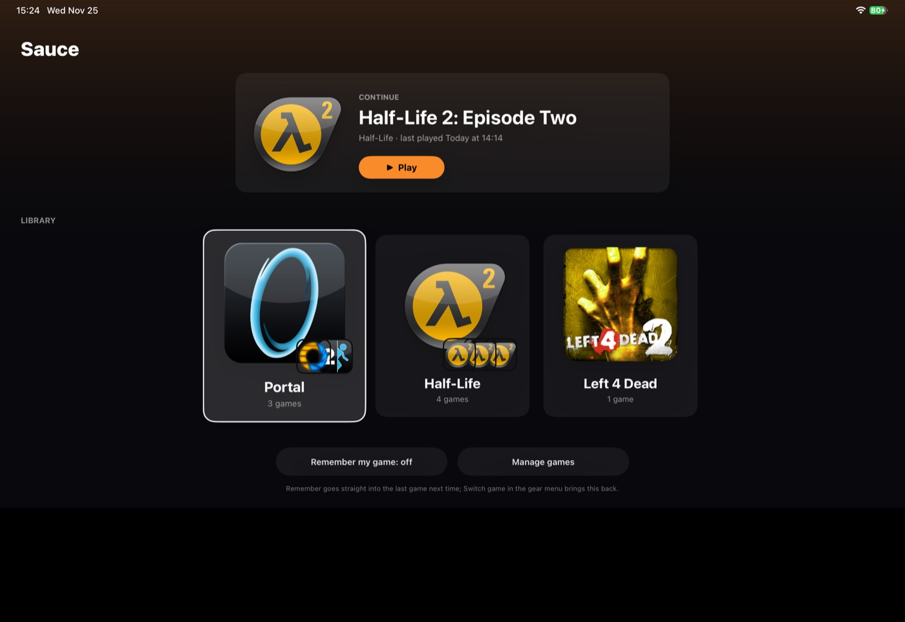

# Fork round 23: Sauce's launcher, TV touch and co-op, P2CE piece D, Apple TV probe

25 November 2026. Apple TV probe first (as asked), then parts A, B, C and E.
Tested on the iPad Pro; the iPad mini got installs only. Sauce is now
**0.6.0-fork.1**.

## Bug causes first (plain English)

- **Touch controls missing on the TV (item 7).** The overlay hides itself
  whenever a game controller *or a keyboard* is connected, until a finger
  touches the screen. The Pro has had a controller paired all day (the gear
  button kept saying "or View Button on the controller"), and a Magic
  Keyboard case counts as a keyboard. Either would have hidden the buttons on
  your monitor test with no visible reason. With the stand-in TV and nothing
  connected, the controls do show on the iPad. Fixed in three ways:
  - the new setting below (Always on);
  - the overlay is re-checked whenever the picture moves to or from a TV;
  - every hide and show is now written to the log with its reason
    ("commandes tactiles : cachées (manette 1, clavier 0, ...)"), so if it
    happens again the log says why.
- **The AirPlay picture looked slightly stretched (item 10).** The game's
  picture size was taken from the screen's *mode* (its pixel grid). An
  AirPlay or HDMI mode can be anamorphic, its pixels not square, so the
  picture's shape could differ from the shape actually shown. Now the shape
  comes from what the screen shows and only the number of lines from the
  mode, so circles stay circles. The mode, its pixel shape and the screen's
  size are logged for your next AirPlay test. AirPlay's 30 fps wasn't chased.
- **The launcher capped at eight games.** The old picker kept its list in
  an eight-entry array: a ninth game would have been dropped. Now 32.
- **Found in P2CE (part C), each fixed with a check:**
  - a deadlock when one "run once" routine started another;
  - two jump-table shapes the lifter didn't recognise;
  - Steam-runtime file functions linked under other names (`__wrap_...`).

## Part A: the launcher

**After (iPad Pro):**

| Main screen | Half-Life series (controller focus on Episode One) |
|---|---|
|  |  |
| **Portal series** | **On a TV (16:9, controller focus on Portal)** |
|  |  |

**How it works:**
- **The main screen:**
  - **"Continue"** at the top: the last game played, big, with Play.
  - **Library:** one tile per series.
    - Portal: Portal, Portal 2, Mel (P2CE and Revolution are listed ahead and appear when Sauce holds them).
    - Half-Life: Half-Life 2, Episode One, Episode Two, Lost Coast.
    - Left 4 Dead: Left 4 Dead 2 (L4D1 is listed ahead).
  - Adding a game to a series is one line in `runtime/ios/game_picker.c`; a test keeps every game of the app in exactly one series.
- **A series screen:**
  - Back, then the series' games on cards that are all the same size.
  - The cover sits in one frame, the title on one line (long names shrink, never wrap), then the size, then the button, all at the same height.
  - The episodes and Lost Coast carry a label (EP1, EP2, LC) on the cover they share with Half-Life 2; inside the Half-Life series their titles drop the "Half-Life 2:" part.
- **A controller:** the D-pad or left stick moves the focus (the card lifts and gets a white edge), A plays or opens, B goes back. Touch works as before.
- **"Remember my game"** goes straight into the last game next time. Switch game in the gear menu brings the launcher back.
- **A game not on the device** shows "Not on this device" and a "How to get it" button. It explains the three steps on the Mac: Natif Installer > Devices > Download.
- **On a TV, or any short screen,** the launcher shrinks to fit instead of cutting off its bottom row.
- **The mini:** no launcher shots from it. Taking one means launching the app there, and the mini is install-only.

## Part B: TV and couch co-op

- **Item 7, touch controls on the TV:** see "Bug causes" above.
- **Item 8, gear menu > TV > Touch controls: Auto / Always on** (in the Settings app too).
  - Auto keeps today's rule.
  - Always on keeps the controls on the iPad even with a controller connected, while the picture is on a TV.
  - "Playing on TV" over the iPad shows only when the controls aren't kept on.
- **Item 9, touch as player 2 in Portal 2 co-op:** built, partly verified.
  - **When it applies:** a co-op map is loaded (on the iPad co-op is always split-screen) and exactly one controller is connected.
  - **What changes:** the touch controls stop sending the keyboard and mouse (which belong to player 1) and drive a full virtual controller. It is plugged in after your controller is re-plugged into the first slot, so it takes the second.
  - **Its buttons follow Portal 2's own controller bindings:** left stick to walk, right stick to look, A jump, B crouch, X use, Start menu, triggers for the two portals.
  - **With no controller,** touch is player 1 as before.
  - **Verified on the Pro:**
    - split-screen co-op runs (`ss_map mp_coop_lobby_3`, two players on screen);
    - the map is detected;
    - the player-2 controller is created in the second slot.
  - **Not verified:** that player 2 then walks. I can't plug in a real controller from here, and in my touch-driven test neither player moved through a virtual controller in split-screen. The ordinary single-player touch controller didn't move a player there either. So split-screen likely hands controllers to players itself (as each player joins), and whether ours is taken needs your hand test with a real controller. That's the first line of the checklist below; if it doesn't work, the log will show which slot each controller got.
- **L4D2 split-screen:** the engine has it (`ss_map`, `connect_splitscreen`, `max_splitscreen_players`, a split-screen config). It would take:
  - raising the player limit to 2;
  - starting with `ss_map` against bots;
  - the same controller-to-player question as Portal 2's;
  - about 20 % more memory for the second view (L4D2 uses about 2 GB alone).

  Not built, as asked.
- **Item 10:** see "Bug causes" above.

## Part C: P2CE piece D (the Steam connection)

The Steam connection now works, and the engine opens.
- **The bridge:** P2CE's Steam calls go to **Valve's own macOS `libsteam_api.dylib`** (the Steamworks.NET 2024.8.0 one Half-Life 2 already uses). The Linux copy isn't loaded at all.
  - Steam starts for P2CE's app (440000) through the Steam client you're logged into on the Mac. Log line: `steam64: SteamInternal_SteamAPI_Init ok (app 440000)`.
  - Nothing faked, no emulator.
  - Your Steam password and key are never read, stored, logged or built in. The Steam client already logged in does the talking.
- **The runtime does three things itself:**
  - it fills the game's Steam context by calling the game's own function;
  - it answers "no" to "should Steam relaunch this app";
  - it delivers Steam's callbacks to the game through Steam's manual dispatch.
- **Valve's interfaces are native arm64 code,** so lifted x86-64 code now calls native code through a small trampoline that moves the arguments between the two calling conventions.
- **How far it gets:**
  - past "Failed to initialize filesystem Steam API context";
  - the file system mounts;
  - with the empty renderer (`-shaderapi shaderapiempty`), **`engine.so` loads and all its start-up code runs**;
  - the launcher then asks for the next engine system, `inputsystem.so` (`AppFramework : Unable to load module inputsystem!`).
- **What's next:**
  - lift the engine's other systems one at a time (input, materials, data cache, physics, sound, VScript) toward the console banner;
  - separately, decide the renderer: P2CE's is Direct3D 11 (DXVK to Vulkan on Linux), which needs a new layer, not the D3D9 one.

  Details: `docs/fork/P2CE_ROUND23_NOTES.md`.

## Part D: Apple TV probe (first, as asked)

A tiny probe app (no game code) ran on "Bedroom".
- **Developer Mode:** never needed. tvOS installed and ran it without asking, so there's nothing for you to switch on yet.
- **Registration:** Xcode registered the Apple TV on your team, which uses one of the year's device slots, as with any new device.

| | Measured on the A2737, tvOS 27.2.1 |
|---|---|
| **Memory limit per app** | **about 2,098 MB** (1,999 MB allocated and touched, 99 MB left; used + available held at 2,098 MB) |
| Increased-memory entitlement | not honoured on tvOS: Xcode drops it from the signature, the limit stays 2,098 MB |
| Box | AppleTV14,1, 4.17 GB physical memory, GPU working set 2,731 MB |
| Writable folders | **only `Library/Caches` and `tmp`**; Documents and Application Support refuse writes |
| Storage | 63.7 GB volume, **38.2 GB free**; tvOS has no "space for important use" query |
| Speed in Caches | 2 GB written at 125 MB/s, read back at 606 MB/s |

**Verdict: unchanged, now measured.**
- 2 GB is a hard ceiling. Portal (about 1.4 GB) and Half-Life 2 (about 1.5 GB) fit.
- Portal 2 (peak 3.2 GB) needs the memory diet in your backlog first.
- Storage is better than feared: 38 GB free holds Portal or Half-Life 2 whole in Caches (which tvOS may purge when space runs low).

Tool: `tools/tvos_probe.sh`; numbers in `docs/fork/APPLETV_RESEARCH.md` section 7.

## Part E: devices and housekeeping

- **iPad mini:**
  - saves backed up (6 saves) and Sauce 0.6.0-fork.1 installed;
  - the old Half-Life 2 and L4D2 apps are gone, as you said;
  - **L4D2's data isn't copied yet:** the mini didn't answer the free-space check (probably locked), and I won't push 16 GB blind. It's under Needs Caspian.
- **iPhone:** backup taken, then Sauce installed.
- **iPad Pro:** Sauce installed (backup first).
- **Backlog:** Left 4 Dead (1) added to `Prompts/backlog.md` (do not build yet).
- **Version:** Sauce 0.6.0-fork.1 (the gear menu's last line).
- **Item 9b (phone as controller):** **not in the prompt file.** `Prompts/23-sauce-launcher-tv-coop.md` has items 1–15, and Part B stops at 10. The only mention is the backlog's one line. Send the 9b text and I'll build it.

## Needs Caspian

1. **Item 9b:** the phone-as-controller web app isn't in `Prompts/23` on disk. Paste it and I'll build it.
2. **iPad mini:** unlock it with the cable in and tell me, and I'll copy L4D2's 16 GB into Sauce. Or run `tools/ios_device.sh --game l4d2 data` with `P2_DEVICE` set to the mini.
3. **Co-op with one controller** (first checklist item below): tell me whether player 2 moves with touch.
4. **The Apple TV port:** the probe settles the numbers. Say if you want round 1 of the port (Portal first).

## Hand re-test checklist (iPad Pro first)

1. **Co-op + touch:** connect one controller, start Portal 2 co-op split-screen, play player 1 on the controller and player 2 by touch (walk, look, jump, both portals). Then disconnect the controller: touch should be player 1 again.
2. **Launcher:**
   - open Sauce: Continue shows your last game;
   - tap each series and use Back;
   - with a controller: D-pad or stick to move, A to open or play, B to go back;
   - turn "Remember my game" on, quit, reopen: straight into that game; gear menu > Switch game brings the launcher back.
3. **TV without a controller:** plug into the monitor or TV. The game goes to the TV and the iPad shows the touch buttons over black; play by touch.
4. **TV with a controller:** the iPad shows "Playing on TV". Set gear menu > TV > Touch controls > Always on, and the buttons come back on the iPad.
5. **AirPlay:** a circle on screen (the portal gun's crosshair ring, or a round light) stays round.
6. **Mini:** after L4D2's copy, the Left 4 Dead series shows it installed.
