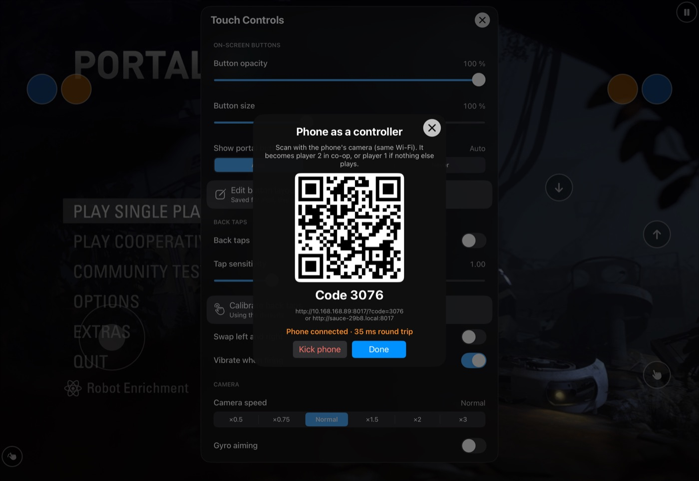
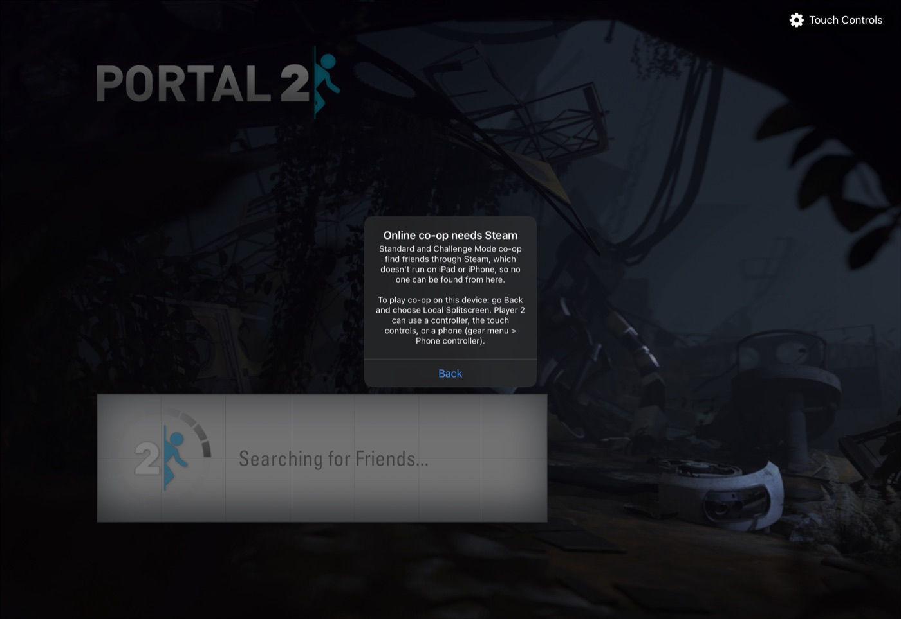
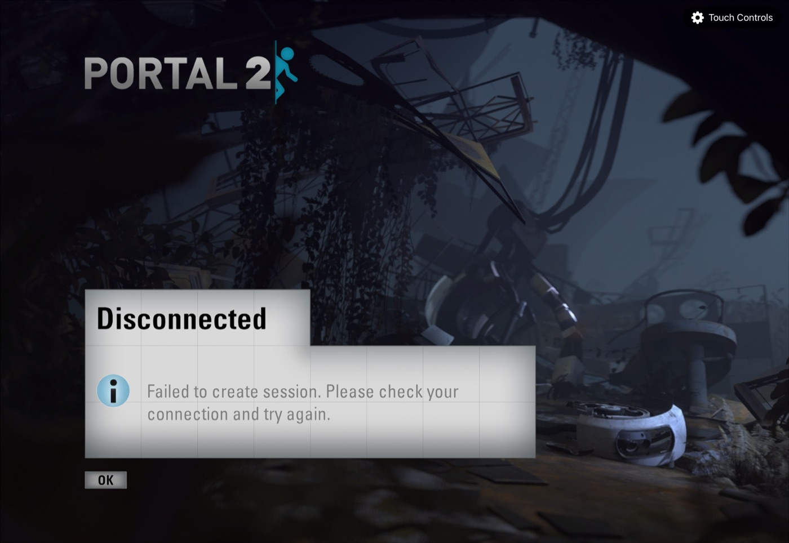

# Fork round 24: phone controller and co-op bugs

25 November 2026. The three bugs from the round 23 hand tests, each diagnosed on
the iPad Pro before it was fixed. The iPad mini and the iPhone got the build
(saves backed up first) but no tests.

## What each bug actually was

### 1. The phone pairing window wouldn't close

- **The cause:** the window did have a Done button, but the window sits on
  top of the gear menu, and the gear menu only lets touches through while it
  is open.
  - When the game leaves its pause menu, the gear menu closes itself. Pressing
    the phone's pause (Start) or jump (A, which is "select" in the game's menus)
    does exactly that.
  - The pairing window then stayed on screen, but Done never got the touch.
  - A controller's B closed the gear menu underneath, not the window.
- **What changed:**
  - The window keeps its touches until it's closed.
  - It has an X in its corner as well as Done.
  - A controller's A or B closes it.
  - It never closes by itself.
- **Closing it:**
  - **With a phone connected,** the phone stays connected and keeps playing. Reopening the window from the gear menu shows "Phone connected" with its round trip.
  - **With no phone connected,** pairing just stops quietly. The next opening shows a new code.
- **Tested on the Pro:** a phone connected, then the gear menu forced shut under the window (as the game does). The X still took the touch and the window closed. The phone stayed connected (1 → 1), and reopening showed it connected.

### 2. Endless portal firing in split-screen co-op

- **The cause:** the "fire released" value was wrong. I measured it on the Pro.
  - SDL's virtual controller (the phone's, and the iPad touch controls' player-2 controller) rests its triggers at the bottom of the joystick range, −32768.
  - When you let go of fire, we wrote 0, which SDL reports to the game as a trigger **half pressed** (16383 out of 32767).
  - After the first shot, the game saw fire held forever. Tapping again just pressed it fully and "released" it back to half.
  - Disconnecting the phone removed the controller, which is why only that stopped it.
  - The same mistake was in the round 23 touch-as-player-2 controller.
- **Why single player seemed fine:** the wrong value was sent there too (I measured 16383 after release in single player as well). The co-op controller setup is evidently stricter about a half-pressed trigger. Either way it's fixed for both.
- **What changed:**
  - **The release value:** release now writes −32768 for the phone and for touch as player 2, and the game then reads 0.
  - **Safety net:** everything the phone holds (fire, buttons, sticks) is released at once when:
    - the phone sends nothing for 2.5 seconds (it pings every second); a lag spike or a dropped connection counts;
    - the page goes to the background (it now sends a "let go" message);
    - Sauce itself goes inactive.
  - A disconnect already unplugged the controller.
- **Test:**
  - A new check runs on every `make check`: press, release, and a second release that changes nothing, on the player-2 pad. It also checks that "let go" clears everything.
  - **On the Pro,** in split-screen co-op (`mp_coop_lobby_3`), with the phone as player 1 and again in the player-2 slot (a stand-in controller in slot 1, SDL player 2):
    - every tap read pressed, then 0 on release;
    - holding fire, then hiding the page, released it;
    - holding fire, then going silent, released it after 2.5 s.
- **Two-controller co-op:** that path never writes the triggers (real controllers report their own), so it's unchanged. I couldn't plug in two real controllers from here; it's on your checklist.

### 3. Play Online stuck on "Searching for Friends"

- **The cause:** reproduced on the Pro with a new Steam call trace.
  - Standard Co-op (and Challenge Mode Co-op) asks Steam to create a lobby, and the partner is meant to come from Steam friends and invites.
  - There is no Steam on iPad or iPhone, so Sauce's stand-in for it never answered, and the game waited forever.
  - **There is no local-network path behind that button at all.** It can never find your iPhone or iPad mini, however long it waits.
- **What changed:**
  - **After 8 seconds** of searching (`P2_ONLINE_TIMEOUT`), Sauce shows: *"Online co-op needs Steam: … doesn't run on iPad or iPhone, so no one can be found from here. To play co-op on this device: go Back and choose Local Splitscreen…"*
  - **Its Back button** gives the game Steam's own "no connection" answer, which is true here, and nothing is faked. The game's own code then closes the search with its usual "Disconnected: Failed to create session" and OK, back to the menu.
  - Escape and engine commands didn't close that dialog (tried on the Pro); this does.
- **Limited to Portal 2:** Half-Life 2 and Left 4 Dead 2 keep their old answers, so their offline paths don't change.
- **Tests:** a check of the timing rules (fires once at 8 s, never once a level has loaded), and the full sequence on the Pro (screenshots below).

| After 8 s | After Back |
|---|---|
|  |  |

**Does local co-op between two devices work now? No.** Making your iPhone and
iPad mini find each other is real new local-network work, so per your
instructions here is the proposal; nothing is built until you say OK.

## Proposal: "Play nearby" (iPhone + iPad co-op on the same Wi-Fi)

What exists today:
- Portal 2's LAN co-op works with **a Mac hosting**, and the other device typing `connect <address>`.
- An iPad or iPhone has **never been tested as the host.**
- Nothing lets two devices find each other.

What I'd build, in order (each step usable and tested on its own):

1. **An iPad hosts (test first, about a session).** Start co-op as host on the iPad Pro, join from the Mac by address. This answers the big unknown: whether iOS can run the host side, and how much memory it needs. The mini has less memory than the Pro, so it may be tight running both the server and the game. If it can't host, the rest changes: the Mac (or the Pro) is always the host.
2. **Find each other with Bonjour (small).** A hosting Sauce advertises itself on the network (`_sauce-coop._tcp`), and other copies list it.
   - iOS shows its one-time "allow local network" prompt; Sauce already has the wording for it.
   - The phone controller already uses Bonjour the same way.
3. **"Play nearby" in the gear menu, or a co-op entry in the launcher.** Two buttons:
   - **Host** starts the co-op lobby;
   - **Join** lists nearby hosts by device name and connects with one tap.

   No typing addresses.
4. **Tests:**
   - a check of the discovery rules;
   - on devices, Pro as host and iPhone joining. That needs your hands, since the iPhone and the mini are install-only.

Not included: play over the internet, or with Steam players on PC. Both need Steam.

**Rough size:** step 1 is a short test, and steps 2–3 are about a round. Say OK, or OK to step 1 only, and I'll start.

## PRs

- [#17](https://github.com/xcaspians/portal2-recomp/pull/17): all three bugs (one commit each) and this report.
  - Merge status: see the final message of this session.

## Devices

- **iPad Pro:** all testing; saves backed up before each install; app closed after each run.
- **iPhone, iPad mini:** saves backed up (mini: 6 saves), the round 24 build installed, nothing launched.
- **Natif Installer:** rebuilt after the merge.

## New switches (for tests; all off by default)

| Switch | Does |
|---|---|
| `P2_STEAM_TRACE=1` | logs each Steam function at its first call |
| `P2_PHONEPAD_QUIET` | seconds of silence before the phone's inputs are released (2.5) |
| `P2_PHONEPAD_TRACE=1` | logs what the game reads from the phone's triggers |
| `P2_PHONEPAD_TEST_SLOT1=1` | a stand-in controller in slot 1, so the phone is player 2 |
| `P2_PHONEPAD_PANEL_CHECK=<s>` | the pairing-window check described above |
| `P2_ONLINE_TIMEOUT` | seconds before the Play Online explanation (8) |
| `P2_ONLINE_NOTICE_TEST_OK=<s>` | presses the explanation's Back after that many seconds |

## Hand re-test checklist

1. **Phone close button:**
   - gear menu > Phone controller, scan with the phone, then tap the X: the window closes and the phone still plays.
   - reopen it: it says "Phone connected". Close it with Done, then with a controller's B.
   - pause the game with the phone's pause while the window is open: the window stays, and its X still works.
   - open it and close it without scanning: no error, and the next opening shows a new code.
2. **Co-op firing, phone as player 1** (no controller connected): Local Splitscreen, fire both portals from the phone. Each tap fires once, and nothing fires after you let go.
3. **Co-op firing, phone as player 2** (a controller connected as player 1): the same with the phone, and with the controller too.
4. **Stuck-input safety net:** hold fire on the phone and lock the phone, or switch apps. The firing stops within about 2.5 s.
5. **Touch as player 2** (one controller connected, the iPad's touch as player 2): fire and release. It stops on release.
6. **Two real controllers in co-op:** still works as before.
7. **Play Online on the iPhone and the iPad mini:**
   - Play Cooperative Game > Standard Co-op: after about 8 s the "Online co-op needs Steam" message appears;
   - Back: the game shows "Failed to create session", and OK returns to the menu;
   - Local Splitscreen still works.
