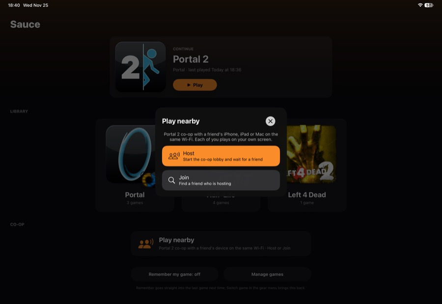
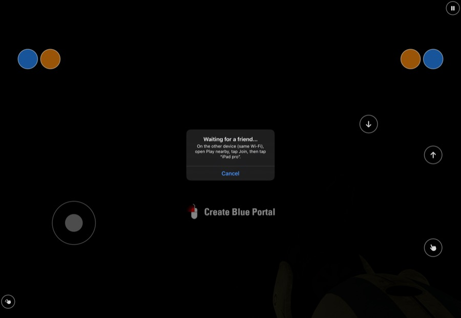
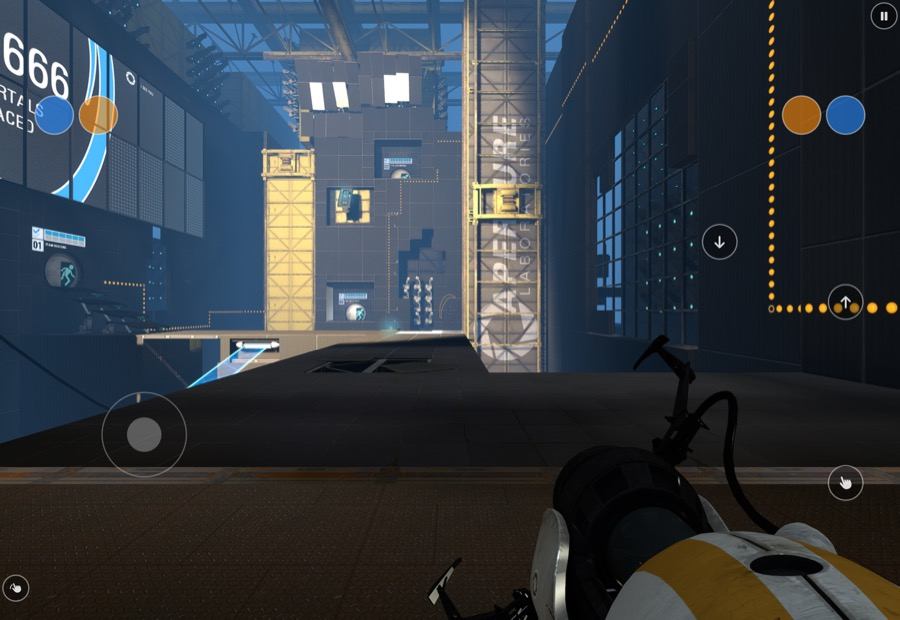
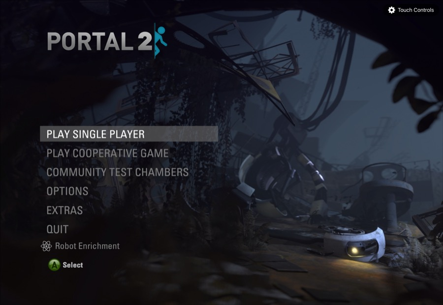
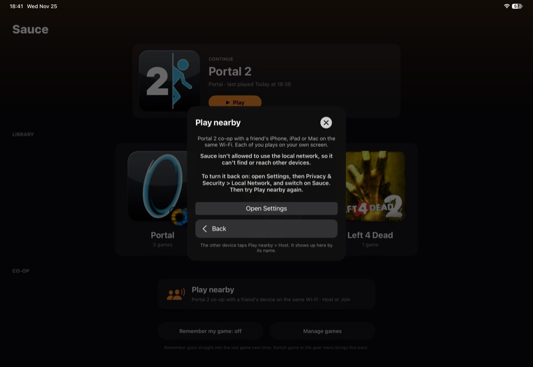

# Fork round 25: Play nearby, plus leftovers

25–26 November 2026. Round 24 (PR #17) was already merged when this round
started. All device testing was on the iPad Pro and the Mac. The iPhone and the
iPad mini only got the build installed (saves backed up first), and nothing was
launched on them.

## 1. Can an iPad host? Yes

- **The test:** the iPad Pro started Portal 2's co-op lobby as host
  (`sv_lan 1`, `map mp_coop_lobby_3`). The Mac joined by address. The Pro's
  server then reported 2 of 2 players, with both in the co-op hub.
- **Memory on the Pro** (iPad Pro 11-inch M5; iOS reports 11.5 GB):
  - while hosting with the Mac connected: **2.15 GB** (Instruments);
  - at its peak during the level load: 2.46 GB;
  - more than 10 GB left before iOS's limit.

  Hosting costs about the same as playing alone, since a Source game always
  runs its own server, even in single player. It held 120 fps.
- **The iPad mini (estimate, not tested):** its earlier logs report 11.8 GB, a
  little more than the Pro, so it should host just as comfortably. Its A20 Pro
  chip is slower than the M5 but already runs the game at 60 fps, and serving
  one friend adds very little work.
- **Result:** no fallback was needed, so I went on with items 2–4.

## 2–4. Play nearby: how it works now

1. **Start it from one of two places:**
   - the Sauce launcher, from the new **Co-op › Play nearby** card;
   - in a game, from **gear menu › Play nearby**.
2. **Host:**
   - Portal 2 opens the co-op lobby. Started from the launcher, the game launches straight into it.
   - Once the lobby is up, the device announces itself on the Wi-Fi under its own name (the Pro showed up as "iPad pro").
   - It shows **"Waiting for a friend…"**, which tells the friend what to tap, with a **Cancel** button (a controller's B works too).
3. **Join:**
   - Sauce lists the devices hosting on the same Wi-Fi, by name.
   - One tap connects; there's nothing to type.
   - A host disappears from the list when it stops hosting, and also once its lobby is full.
4. **While you play,** each side asks the game server every 2 seconds how many players it has:
   - **Host:** if the friend leaves or drops, it shows *"Your friend left…"*, then the main menu.
   - **Guest:** if the host goes quiet for 20 seconds, it shows *"Lost the connection to [name]…"*, then the main menu.
   - **Map changes** have a grace period, so a co-op level change doesn't count as a drop.
5. **Local network permission:**
   - iOS asks once, the first time you open Join. The new wording: *"Sauce uses your Wi-Fi to find friends' devices for co-op (Play nearby) and to connect a phone as a controller. Nothing leaves your network."*
   - If you decline, the Join screen says so in plain words, explains how to turn it back on (Settings › Privacy & Security › Local Network), and offers an **Open Settings** button.

| Launcher | Waiting (host) | Guest in the hub | Back at the menu after a drop |
|---|---|---|---|
|  |  |  |  |

Local network declined: 

**Tested on the Pro with the Mac:**

| Test | Result |
|---|---|
| **Pro hosts from the launcher, Mac joins** | "Waiting" shown, then hidden when the Mac arrived. The announcement was withdrawn. |
| **Mac quits** | The Pro said "Your friend left" and went back to the menu. |
| **Leave and rejoin, no restart** | The Pro hosted again from inside the game, and the Mac joined again. |
| **Mac hosts, Pro joins from the launcher's list** | Joined with one tap; both were in the hub. |
| **Mac hosts, Pro joins from the gear menu** | Same result. |
| **Mac quits, Pro is the guest** | The Pro said "Connection lost" and landed on a clean main menu. |
| **Split-screen co-op** (`ss_map mp_coop_lobby_3`) | Still works. |

- **The Mac's side of the Mac-host tests:** the Mac game has no Sauce launcher, so it doesn't announce itself. For those tests I announced it with `dns-sd`; that command is in docs/usage.md.
- **A bug found and fixed while testing:**
  - On the first drop test, "disconnect" left Portal 2's pause menu stuck on screen over the main menu.
  - Sauce now hides the game's menu before disconnecting, and the game then draws its main menu fresh.
- **Not tested here:**
  - Play Online's round 24 notice: none of its code changed this round.
  - Two iOS devices together: that's on your checklist.

## 5. Zoom button

- **Where:** Portal 2's touch layout now has a zoom button on the left, between the portal buttons and the stick.
- **How it works:**
  - **The game's own zoom** is a toggle: each press of its zoom key or button flips it. On the Pro the game then showed "Unzoom".
  - **The new button** taps zoom when you press it and again when you let go, so it works as hold to zoom.
  - **Touch as player 2:** it sends the controller's right bumper, which is the game's zoom on a controller.
- **Settings:** like any other button, you can move and resize it in Edit button layout.
- **Tested on the Pro:** zoomed in while held, and back out when released. Screenshots: [held](round25/zoom-held.jpg), [released](round25/zoom-released.jpg).

## 6. Controls from the launcher

- **Where:** the launcher has a **Controls** button next to Remember and Manage games ([screenshot](round25/launcher-controls.jpg)).
- **What it opens:** the gear menu's panel, with the settings every game shares:
  - buttons, back taps, camera, gyro, display and TV;
  - Edit button layout.
- **What's left out:** things that need a running game (Maps, Switch game, Phone controller, Play nearby), and each game's own iCloud switch.
- **Tested on the Pro:** Button size set to 125 % from the launcher was saved and used by the game. I then put it back to 100 %.
- **Test:** a check that every setting shown in the launcher is stored under the same name in every game.

## 7. Left 4 Dead 2's touch stick: not reproduced

I couldn't make it fail on the iPad Pro. The stick moved the player every time, in five tests:

- starting the map from the command line;
- starting from L4D2's main menu, through its "-insecure" warning, as you would;
- partial tilts (30 % and 60 %);
- the camera turning while walking, as the gyro or the camera stick would do;
- a synthetic finger fed through the touch overlay's own handlers, which is the same path a real thumb takes.

Two things I ruled out:

- **Your L4D2 settings:** the config saved on the Pro and on the mini is identical (joystick on).
- **The mini's custom button layout:** everything in it sits on the right side, nowhere near the stick.

**One real finding, but not the cause:** L4D2 and Portal 2 both shut down
SDL's game-controller system at startup, which destroys any virtual
controller alive at that moment. At startup that's harmless, because the touch
stick's controller is created afterwards. If it ever happened mid-game, the
stick would silently stop working. Sauce now logs it (`le jeu arrête les
manettes`), and if the stick's controller disappears it recreates it
(`manette virtuelle : détachée par le jeu, recréée`). I'm not claiming this
fixes your bug, since I never saw it happen. No test comes with it, because
there is no confirmed cause to test.

**What I need from you:** the steps that fail (which device, and how you
start the game). Or turn on the Log setting, reproduce it, and send me
`game.log`.

## 8. The iCloud signing project

- **The cause:** XcodeGen 2.46, the tool that generates the signing project, writes any nested value in a target's `attributes` as text. I tried YAML flow style, quoted keys, strings, booleans and a JSON spec, and every one came out as `"[\"com.apple.iCloud\": [\"enabled\": 1]]"`. Xcode can't read that, so its Signing & Capabilities tab could neither show nor add iCloud.
- **The fix:**
  - `project-icloud.yml` now runs a small script right after generation (XcodeGen's `postGenCommand`).
  - The script, `ios/signing/capabilities.py`, rewrites that one entry as the dictionary Xcode itself writes.
  - The container is unchanged: still `iCloud.local.portal2recomp.vn8jwve7jx`, with no second one.
- **Test:** `tests/test_ios_signing_project.py` checks the text fix, plus a real `xcodegen` run. It reads the generated project and checks for a dictionary, and that the entitlements name that one container.
- **Your local project:** I regenerated `ios/signing/P2Signing.xcodeproj` with the fix.
- **Why Sauce still says "iCloud isn't available":** the profile on your devices has iCloud but no container. The build log says so: "profil avec iCloud mais sans conteneur". Getting it into the profile needs your Apple account; see below.

## What you need to do by hand (iCloud)

1. Connect and unlock the **iPhone** (Developer Mode on).
2. Open `ios/signing/P2Signing.xcodeproj` in Xcode, then go to the **Portal2** target › **Signing & Capabilities**.
3. iCloud should now be listed. Under it, tick **iCloud Documents**, and in Containers tick the existing **iCloud.local.portal2recomp.vn8jwve7jx**.
   - Don't press **+**: that would create a new container.
   - If iCloud isn't listed, click **+ Capability › iCloud**, then do the same.
4. Press **⌘B** once, so Xcode fetches a profile that includes the container.
5. In Terminal: `./setup.sh --ios --game portal2`. It rebuilds, signs with that profile and installs.
6. Install on the iPads too: `P2_DEVICE=<UDID> tools/ios_device.sh install`.
7. In Sauce, gear menu › iCloud saves should now show "Last synced…" instead of "isn't available".

## PRs

- [#18](https://github.com/xcaspians/portal2-recomp/pull/18): items 2–3 (two commits: the discovery rules and permission prompt, then Host/Join), then one commit each for 5, 6, 7 and 8, the docs, and this report.
  - Merge status: see the final message of this session.

## Devices

- **iPad Pro:** all testing. Saves were backed up before the first install. The app was closed after every run.
- **iPhone, iPad mini:** saves backed up, final build installed, nothing launched.
- **Natif Installer:** rebuilt after the merge.

## New switches (for tests; all off by default)

| Switch | Does |
|---|---|
| `P2_NEARBY_OPEN=1` | the launcher opens with Play nearby showing |
| `P2_NEARBY_TEST=host\|join` | presses Host, or the first host listed |
| `P2_NEARBY_TEST_OK=<s>` | presses OK on Play nearby's messages after that many seconds |
| `P2_NEARBY_TEST_CANCEL=<s>` | presses Cancel on "Waiting for a friend…" |
| `P2_NEARBY_TEST_LEAVE=<s>` | leaves that long after playing together |
| `P2_NEARBY_TEST_AGAIN=1` | after a session ends, hosts or joins again from inside the game |
| `P2_NEARBY_TEST_DENIED=1` | shows the "local network declined" screen |
| `P2_SETTINGS_MENU_OPEN=nearby` | the gear menu opens on Play nearby |
| `P2_CONTROLS_OPEN=1`, `P2_CONTROLS_TEST=<key>=<value>` | the launcher's Controls panel, setting one row |
| `P2_TOUCH_TEST_HOLD=<button>,<after>,<for>` | holds a touch button (e.g. `zoom`) |
| `P2_TOUCH_TEST_FINGER=fx,fy,dx,dy,after,for` | a synthetic finger through the touch overlay |
| `P2_TOUCH_TEST_LOOK=<points>` | turns the camera during the stick test |

## Hand re-test checklist

1. **Play nearby, iPad hosts and iPhone joins:**
   - iPad: launcher › Play nearby › **Host**. You see "Waiting for a friend…".
   - iPhone: launcher › Play nearby › **Join**. The iPad shows up by name; tap it.
   - Both of you land in the co-op hub, each on your own screen.
2. **Play nearby, the other way:** iPhone hosts, iPad joins. Try it once from the gear menu instead of the launcher.
3. **Drops:**
   - Quit the guest: the host says "Your friend left" and goes to the menu.
   - Quit the host: the guest says "Connection lost" after about 20 s and goes to the menu.
   - Then host and join again without restarting either app.
4. **Cancel:** Host, then Cancel on "Waiting for a friend…". You're back at the menu, and the other device's Join list loses the host.
5. **Local network prompt:**
   - On a device that never allowed it, Join shows iOS's prompt with the new wording.
   - Decline it: Join explains, and **Open Settings** goes to Sauce's page.
   - Allow it there, come back, and Join lists hosts.
6. **Zoom button** (Portal 2): hold it to zoom, let go to zoom out. Move and resize it in Edit button layout.
7. **Controls from the launcher:** launcher › Controls, change Button size, close, play any game: the buttons have the new size.
8. **L4D2 stick:**
   - Start a campaign as you usually do and walk with the stick.
   - If it still doesn't move, note the device and the steps, and send `game.log` (Log setting on).
9. **iCloud:** do "What you need to do by hand" above. Then gear menu › iCloud saves shows "Last synced…", on the iPhone and an iPad.
10. **Still working:**
    - split-screen co-op;
    - Play Cooperative Game › Standard Co-op shows the "Online co-op needs Steam" notice after about 8 s.
